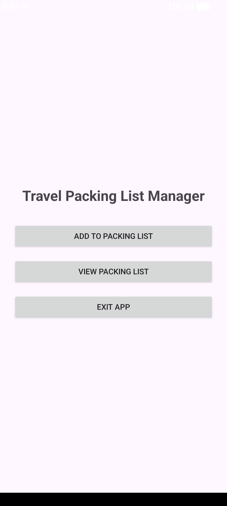

# Travel Packing List Manager

## 1. Introduction

The Travel Packing List Manager is an Android application developed using Kotlin and Android Studio.

The application is designed to help users organise items they need when preparing for a trip.

## 2. Application Features

- Main screen with navigation buttons.
- Add items to a packing list.
- View saved packing list items.
- Exit the application.

## 3. Technologies Used

- Android Studio
- Kotlin
- XML
- Android Emulator

## 4. Screenshots

### Main Screen

### Add to Packing List

### View Packing List

## 5. Developer

Name: [Tracy Chilembo]

Project: Travel Packing List Manager
